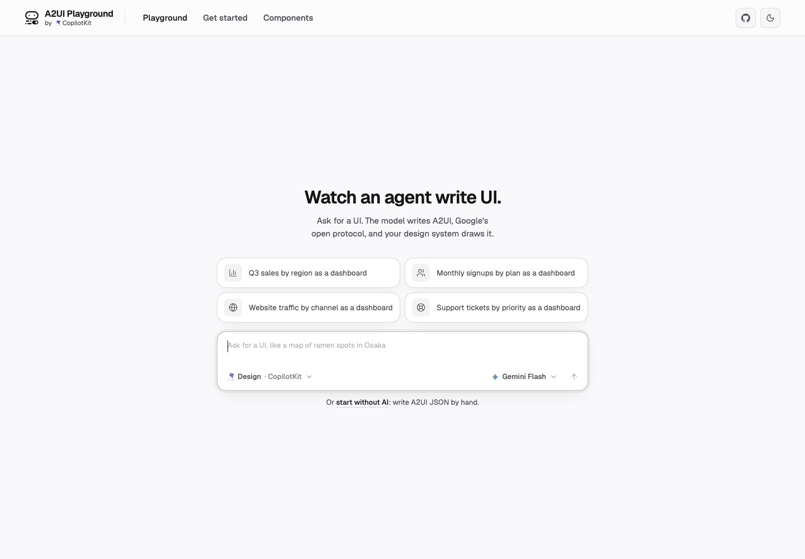
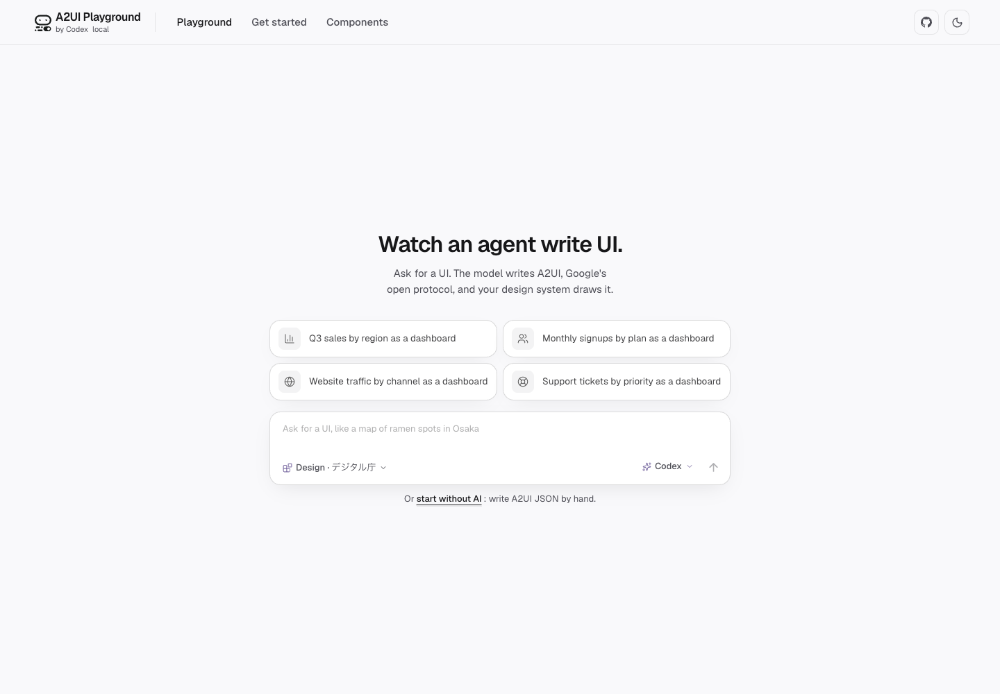
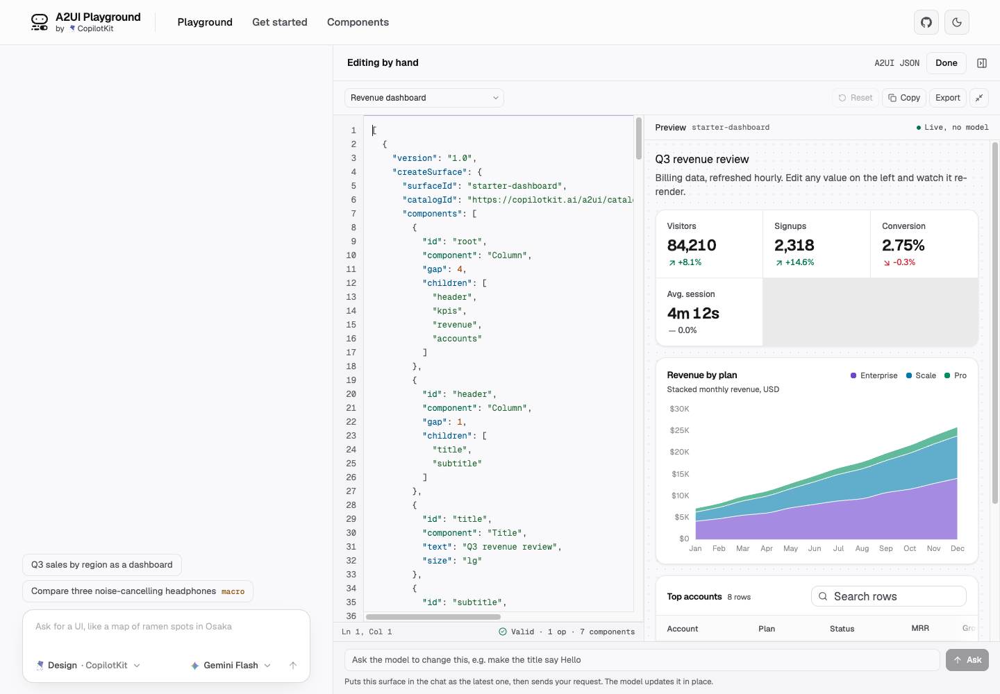
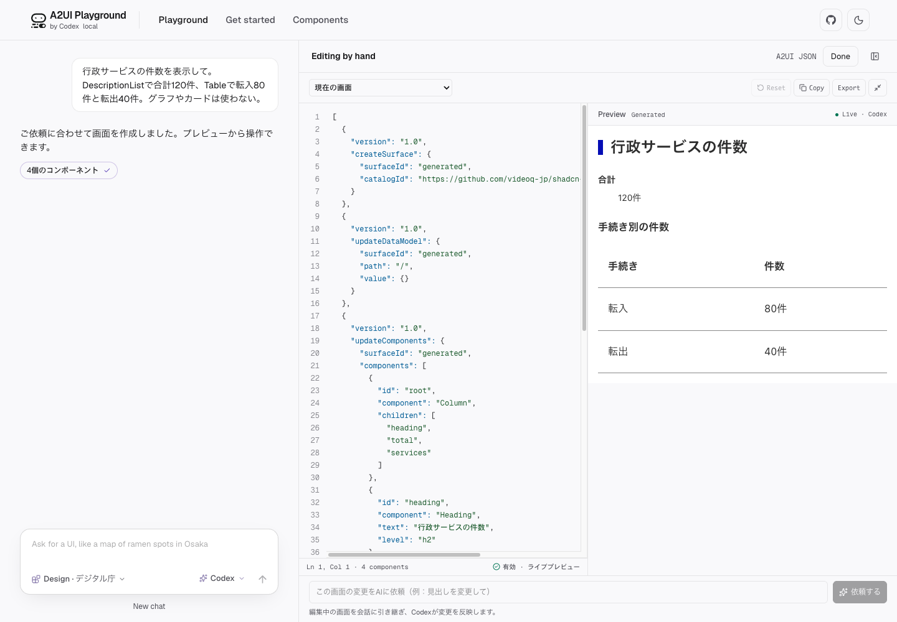

# 本家との表示比較

比較対象は <https://a2ui.open.bot/>。同じego-browserで1440×1000、deviceScaleFactor 1に揃え、フォント読み込みと開始画面のアニメーション完了後に取得した。画像の加工はしていない。

**生成されるA2UIはデジタル庁デザイン、周囲の画面は本家の構成を使う。** 生成領域にGeistや本家のカード装飾を上書きしない。外側には本家と同じGeist/Geist Mono、背景色、角丸、余白、会話とコードの配置を使う。モデル名・副表示はこのPCのCodex接続を示す。

## 開始画面

| 実測項目                | 本家           | ローカル       |
| ----------------------- | -------------- | -------------- |
| 見出し上端              | 336.05px       | 335.47px       |
| 見出しの書体サイズ/行高 | 32px / 34.56px | 32px / 34.56px |
| 入力欄の左端            | 388px          | 388px          |
| 入力欄の上端            | 593.09px       | 592.52px       |
| 入力欄の幅×高さ         | 664×106px      | 664×106px      |

[実測JSON](./a2ui-comparison/measurements.json)

本家:

ローカル:

## JSON編集画面

左に会話、右にJSONとプレビューを置く。本家のプレビュー境界はx=944px、ローカルはx=943.98px。生成領域の青い見出し、説明リスト、表、文字サイズはデジタル庁カタログのもので、本家の生成UIとは意図的に異なる。

本家:

ローカル（このPCのCodexで生成した既存Heading・DescriptionList・Table）:

## 再現範囲

開始画面・会話を主領域にした配置・右側インスペクター・編集モード・Designメニューを本家へ合わせた。生成UIの部品はこのリポジトリのカタログ、モデルはCodex、生成形式はA2UI JSON。本家のExpress形式、他プロバイダー、全カタログの機能まで同一実装になったという意味ではない。

A2UIマークとスタイルの参照元はCopilotKit（MIT）。フォントはGeist（SIL OFL）。ライセンスは`src/demo/assets`に保存し、使い方ダイアログから参照できる。
